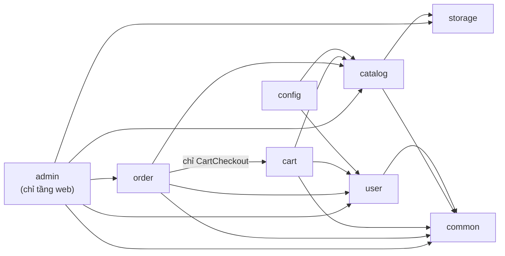
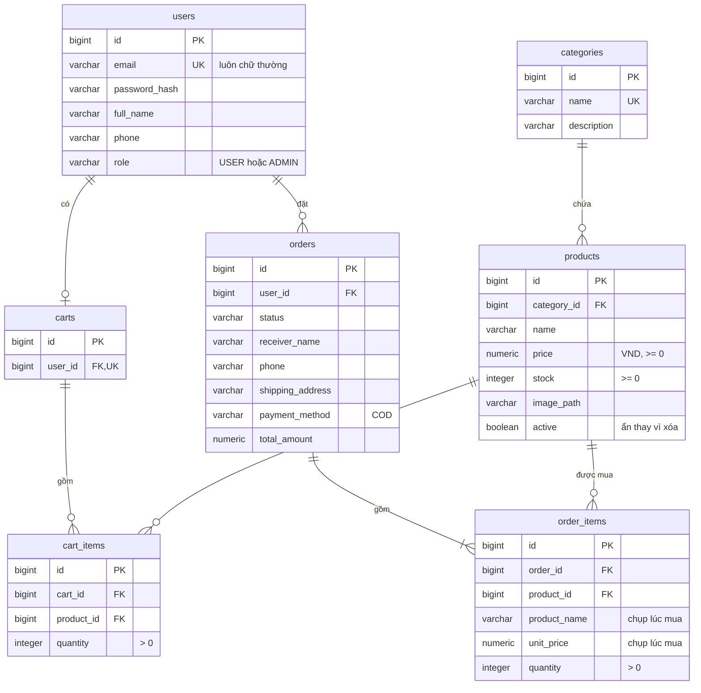

# Mini Shop

[](https://github.com/Luffyreals/mini-shop/actions/workflows/ci.yml)

Website bán hàng mini viết bằng Java / Spring Boot, render phía server. Đây là dự án học tập và portfolio, **không bán hàng thật**.

> 🚧 **Đang phát triển.** Đã xong GĐ1 (`v0.1.0`, nền móng), GĐ2 (`v0.2.0`, danh sách và chi tiết sản phẩm tại http://localhost:8080), GĐ3 (`v0.3.0`, đăng ký, đăng nhập, phân quyền), GĐ4 (`v0.4.0`, giỏ hàng), GĐ5 (`v0.5.0`, đặt hàng COD, lịch sử đơn, tự hủy đơn), GĐ6 (`v0.6.0`, trang quản trị: dashboard, danh mục, sản phẩm có ảnh, tồn kho, đơn hàng) và GĐ7 (trang lỗi, validation, truy cập, README). Tiếp theo: GĐ8 deploy online (tùy chọn). Tiến độ xem ở mục [Lộ trình](#lộ-trình).

## Tính năng (MVP)

**Khách hàng**
- Xem sản phẩm: phân trang, tìm theo tên, lọc theo danh mục, sắp xếp theo giá; trang chi tiết sản phẩm
- Giỏ hàng: lưu trong session khi chưa đăng nhập, gộp vào tài khoản khi đăng nhập
- Đăng ký / đăng nhập
- Đặt hàng thanh toán khi nhận hàng (COD), xem lịch sử đơn, tự hủy đơn đang chờ xử lý

**Quản trị (`/admin`)**
- Dashboard: số đơn theo từng trạng thái, doanh thu đơn đã giao, sản phẩm sắp hết hàng, đơn mới nhất
- Quản lý danh mục và sản phẩm (có upload ảnh JPG/PNG/WebP), ẩn/hiện sản phẩm, nhập thêm hoặc giảm tồn kho
- Quản lý đơn hàng: lọc theo trạng thái, đổi trạng thái; hủy đơn thì tự hoàn lại tồn kho

**Hoàn thiện**
- Trang lỗi tiếng Việt cho 404, 400/405, phiên làm việc hết hạn (CSRF), tệp quá lớn (413), lỗi hệ thống (500); không bao giờ lộ stack trace
- Form tự bỏ ký tự vô hình, nhận số điện thoại dạng `+84…`; link "Bỏ qua đến nội dung chính", focus rõ ràng, tương phản theo WCAG 2.1 AA

## Ảnh chụp

| Danh sách sản phẩm | Chi tiết sản phẩm |
|---|---|
|  |  |
| **Giỏ hàng** | **Thanh toán** |
|  |  |
| **Chi tiết đơn của khách** | **Dashboard quản trị** |
|  |  |
| **Chi tiết đơn trong quản trị** | |
|  | |

Ảnh chụp từ app chạy profile `h2` với dữ liệu mẫu (tên, số điện thoại, địa chỉ đều là dữ liệu giả). Ảnh sản phẩm trong đó dùng giấy phép mở, một số theo CC BY / CC BY-SA: tác giả và giấy phép từng ảnh ở [`credits.html`](src/main/resources/static/credits.html); ảnh chụp màn hình được chia sẻ theo cùng điều kiện.

## Công nghệ

| | |
|---|---|
| Ngôn ngữ | Java 25 |
| Framework | Spring Boot 4.1: Web MVC, Data JPA, Security, Validation |
| Giao diện | Thymeleaf, Bootstrap 5.3 |
| Cơ sở dữ liệu | PostgreSQL, Flyway (H2 làm phương án dự phòng) |
| Kiểm thử | JUnit 5, Mockito, AssertJ, MockMvc, Testcontainers |
| Build | Maven Wrapper, Docker Compose |

Lý do chọn từng công nghệ: xem [docs/adr](docs/adr/README.md).

## Kiến trúc

Modular monolith: chia package theo tính năng (`catalog`, `cart`, `order`, `user`, `admin`…). Trong mỗi tính năng phân lớp controller → service → repository. Một vài điểm thiết kế đáng chú ý:

- Trừ tồn kho bằng câu `UPDATE` nguyên tử nên không bán vượt kho khi nhiều người đặt cùng lúc ([ADR-0005](docs/adr/0005-atomic-stock-decrement.md))
- Đơn hàng lưu lại tên và giá sản phẩm tại thời điểm mua
- Luồng trạng thái đơn được kiểm soát chặt: `PENDING → CONFIRMED → SHIPPING → DELIVERED`, hoặc `CANCELLED`
- Admin chỉnh tồn kho bằng một câu `UPDATE` có điều kiện nên không ghi đè số khách vừa mua; ảnh upload được kiểm cả nội dung file (magic bytes) và lưu bằng tên ngẫu nhiên ([ADR-0010](docs/adr/0010-product-images-and-admin-stock-adjustment.md))

**Các package và chiều phụ thuộc** (mũi tên = "được phép dùng"; `ArchitectureTest` làm build thất bại nếu sai):



`common` và `storage` không phụ thuộc tính năng nào; không ai phụ thuộc vào `admin`.

**Các bảng** (Flyway `V1`, `V2`):



Chi tiết: [docs/project-brief.md](docs/project-brief.md).

## Quyết định thiết kế

Mỗi quyết định có một ADR ghi bối cảnh, lựa chọn và phương án đã loại ([docs/adr](docs/adr/README.md)):

| ADR | Chọn gì | Vì sao |
|---|---|---|
| [0001](docs/adr/0001-java-25-spring-boot-4.md) | Java 25, Spring Boot 4.1 | Bản LTS mới nhất; dòng Boot 3.x đã hết hỗ trợ miễn phí |
| [0002](docs/adr/0002-modular-monolith-package-by-feature.md) | Modular monolith, package theo tính năng | Một người, một miền nghiệp vụ nhỏ; ranh giới module được kiểm bằng ArchUnit |
| [0003](docs/adr/0003-server-side-rendering-thymeleaf.md) | Render phía server bằng Thymeleaf | Một dự án, session + CSRF có sẵn, tập trung học Spring |
| [0004](docs/adr/0004-postgresql-flyway.md) | PostgreSQL mọi môi trường, Flyway | Dev và test chạy đúng loại DB thật; schema có lịch sử bằng SQL |
| [0005](docs/adr/0005-atomic-stock-decrement.md) | Trừ kho bằng `UPDATE … WHERE stock >= :q` | Không bán vượt kho khi nhiều người đặt cùng lúc, không cần khóa thủ công |
| [0006](docs/adr/0006-session-cart-merged-on-login.md) | Giỏ trong session cho khách, trong DB cho user, gộp khi đăng nhập | Khách mua được ngay, không mất giỏ khi đăng nhập |
| [0007](docs/adr/0007-session-form-login-current-user.md) | Đăng nhập bằng form trên session, principal riêng | Không giữ entity trong session; email luôn chữ thường |
| [0008](docs/adr/0008-cart-writes-serialized-per-user.md) | Ghi giỏ DB tuần tự theo người dùng (khóa dòng `users`) | Hai tab cùng sửa giỏ không ghi đè nhau |
| [0009](docs/adr/0009-order-placement-and-cancel-locking.md) | Thứ tự khóa cố định khi đặt và hủy đơn | Không deadlock, kho chỉ được hoàn một lần |
| [0010](docs/adr/0010-product-images-and-admin-stock-adjustment.md) | Ảnh qua `StorageService`, admin chỉnh kho bằng `UPDATE` có điều kiện | File upload không thành bề mặt tấn công; không ghi đè số khách vừa mua |
| [0011](docs/adr/0011-centralized-error-handling.md) | Xử lý lỗi tập trung | Mọi lỗi có trang tiếng Việt đúng mã, không lộ chi tiết; mỗi lỗi 500 ghi log đúng một lần |

## Bắt đầu nhanh

Yêu cầu: **JDK 25** và **Docker Desktop đang chạy**. Không cần cài Maven vì dự án dùng Maven Wrapper; lần chạy đầu sẽ tự tải Maven về.

```bash
./mvnw spring-boot:run
```

Mở http://localhost:8080. PostgreSQL được Spring Boot tự bật từ `compose.yaml`. Dừng app bằng `Ctrl+C`; container PostgreSQL dừng theo. Nếu app bị tắt đột ngột (đóng terminal, kill tiến trình) thì container vẫn chạy: dừng nó bằng `docker compose stop`.

| Việc cần làm | Lệnh |
|---|---|
| Chạy khi **không có Docker** (H2 trong bộ nhớ, có `/h2-console`) | `./mvnw spring-boot:run -Dspring-boot.run.profiles=h2` |
| Build và chạy toàn bộ test | `./mvnw verify` |
| Chạy một lớp test | `./mvnw test -Dtest=ProductControllerTest` |
| Kiểm tra không có test nào bị bỏ qua (CI cũng chạy bước này) | `bash .github/scripts/check-no-skipped-tests.sh` |
| Xem độ phủ test | mở `target/site/jacoco/index.html` sau khi chạy `./mvnw verify` |

Trên Windows PowerShell, thay `./mvnw` bằng `.\mvnw.cmd`. Máy không bật Docker thì các test dùng Testcontainers sẽ được bỏ qua; CI luôn chạy đủ và báo lỗi nếu có test bị bỏ qua.

### Tài khoản demo

Được tạo tự động khi app khởi động với DB trống. **Chỉ dùng cho môi trường dev.**

| Vai trò | Email | Mật khẩu |
|---|---|---|
| Quản trị (ADMIN) | `admin@minishop.local` | `Admin@123` |
| Khách hàng (USER) | `user@minishop.local` | `User@123` |

Đổi mật khẩu demo bằng biến môi trường `SEED_ADMIN_PASSWORD` và `SEED_USER_PASSWORD`.

Đăng nhập ở http://localhost:8080/login. Tạo tài khoản mới (luôn là `USER`) ở http://localhost:8080/register: mật khẩu 8–64 ký tự, có cả chữ và số. Chỉ tài khoản `ADMIN` vào được `/admin`. Sau khi đăng nhập, bấm "Đặt hàng" ở trang giỏ để thanh toán khi nhận hàng (COD); đơn đã đặt nằm ở "Đơn hàng của tôi" (http://localhost:8080/orders), đơn đang "Chờ xử lý" có thể tự hủy.

Đăng nhập bằng `admin@minishop.local` rồi bấm "Quản trị" trên header để vào http://localhost:8080/admin: xử lý đơn (xác nhận, giao, hủy), thêm/sửa danh mục và sản phẩm, upload ảnh, điều chỉnh tồn kho. Ảnh upload được lưu ở thư mục `uploads/` (không commit); đặt biến môi trường `UPLOAD_DIR` để dùng thư mục khác.

Dữ liệu mẫu gồm 5 danh mục và 22 sản phẩm, trong đó có 1 sản phẩm hết hàng và 1 sản phẩm bị ẩn, để thử các trường hợp đặc biệt. 19 sản phẩm có ảnh; 3 sản phẩm cố ý không có ảnh để kiểm tra ảnh thay thế.

> **Dữ liệu mẫu chỉ được tạo khi DB trống.** PostgreSQL dev lưu dữ liệu trong volume Docker `mini-shop_postgres-data`, nên sau khi dữ liệu mẫu thay đổi (ví dụ thêm ảnh ở GĐ2), hãy xóa volume để seed lại:
>
> ```bash
> docker compose down -v
> ```
>
> Profile `h2` luôn seed lại vì dùng DB trong bộ nhớ.

### Ảnh và font: nguồn và giấy phép

Ảnh sản phẩm là ảnh minh họa có giấy phép mở (CC0, public domain, CC BY, CC BY-SA), **không phải ảnh của sản phẩm thật**. Danh sách đầy đủ (tác giả, giấy phép, link gốc) nằm ở trang `/credits.html` của ứng dụng, có link "Nguồn ảnh" ở footer mọi trang. Font **Bricolage Grotesque** dùng giấy phép SIL OFL 1.1 (`static/fonts/OFL.txt`). Muốn thêm hoặc đổi ảnh, cập nhật cả `static/credits.html`.

## Xử lý sự cố

| Triệu chứng | Cách xử lý |
|---|---|
| `./mvnw spring-boot:run` báo không kết nối được Docker / PostgreSQL | Mở Docker Desktop và chờ nó chạy xong, rồi chạy lại. Không có Docker thì dùng profile `h2` (bảng ở mục [Bắt đầu nhanh](#bắt-đầu-nhanh)). |
| `Port 8080 was already in use` | Tắt chương trình đang dùng cổng 8080, hoặc chạy ở cổng khác: `./mvnw spring-boot:run "-Dspring-boot.run.arguments=--server.port=8081"` rồi mở http://localhost:8081. |
| Dữ liệu mẫu không cập nhật (thiếu ảnh, thiếu sản phẩm mới) | Dữ liệu mẫu chỉ được tạo khi DB trống. Xóa volume rồi chạy lại: `docker compose down -v`. |
| `./mvnw verify` báo nhiều test bị bỏ qua (`Skipped`) | Các test Testcontainers chỉ chạy khi Docker đang bật. Bật Docker Desktop rồi chạy lại; kiểm bằng `bash .github/scripts/check-no-skipped-tests.sh`. |
| Trên Windows PowerShell lệnh `./mvnw` không chạy, hoặc tham số `-D…` bị hiểu sai | Dùng `.\mvnw.cmd` và đặt tham số `-D` trong nháy kép: `.\mvnw.cmd spring-boot:run "-Dspring-boot.run.profiles=h2"`. Git Bash dùng `./mvnw` như bình thường. |
| Ảnh upload nằm ở đâu, muốn đổi thư mục | Mặc định `uploads/` ở thư mục gốc (không commit). Đổi bằng biến môi trường `UPLOAD_DIR`: Git Bash `UPLOAD_DIR=/tmp/minishop-uploads ./mvnw spring-boot:run`; PowerShell `$env:UPLOAD_DIR = "C:\minishop-uploads"; .\mvnw.cmd spring-boot:run`. |

## Cấu trúc repo

```
mini-shop/
├── src/main/java/com/minishop/
│   ├── catalog/ cart/ order/ user/   Các tính năng nghiệp vụ
│   ├── admin/                        Tầng web của khu quản trị
│   └── storage/ common/ config/      Lưu file, thành phần dùng chung, cấu hình
├── src/main/resources/  application*.yml, db/migration (Flyway), templates, static
├── compose.yaml         PostgreSQL cho dev
├── docs/
│   ├── project-brief.md Phạm vi, kiến trúc, lộ trình
│   ├── specs/           Đặc tả tính năng và tiêu chí chấp nhận
│   ├── adr/             Các quyết định kiến trúc
│   └── plans/           Kế hoạch chi tiết từng giai đoạn
├── .github/             CI, Dependabot, template PR và issue
├── .claude/             Subagent, skill /write-spec, cấu hình Claude Code
├── CLAUDE.md            Hướng dẫn cho Claude Code
├── CONTRIBUTING.md      Quy trình nhánh, commit, phát hành
└── CHANGELOG.md
```

## Lộ trình

- [x] GĐ1: Khởi tạo project, CI, entity, migration, dữ liệu mẫu (`v0.1.0`)
- [x] GĐ2: Danh sách và chi tiết sản phẩm (`v0.2.0`)
- [x] GĐ3: Đăng ký, đăng nhập, phân quyền (`v0.3.0`)
- [x] GĐ4: Giỏ hàng (`v0.4.0`)
- [x] GĐ5: Đặt hàng và lịch sử đơn (`v0.5.0`)
- [x] GĐ6: Trang quản trị (`v0.6.0`)
- [x] GĐ7: Hoàn thiện (validation, xử lý lỗi, giao diện, tài liệu)
- [ ] GĐ8: Deploy online *(tùy chọn)*

## Hướng phát triển

Ngoài phạm vi MVP, có thể làm sau:
- Quên mật khẩu (cần gửi email)
- Tìm đơn theo email, số điện thoại, mã đơn trong trang quản trị; lọc sản phẩm quản trị theo danh mục
- Deploy online (GĐ8): Docker image, PostgreSQL được quản lý, lưu ảnh trên dịch vụ đám mây, giới hạn số lần đăng nhập sai

## Đóng góp

Xem [CONTRIBUTING.md](CONTRIBUTING.md).

## Giấy phép

[MIT](LICENSE)
