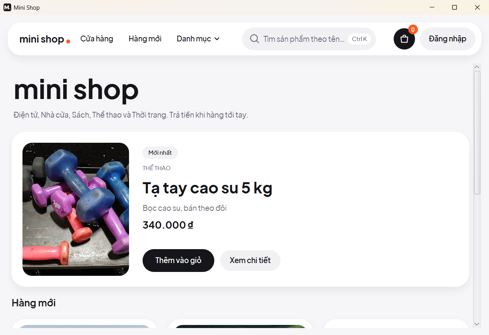
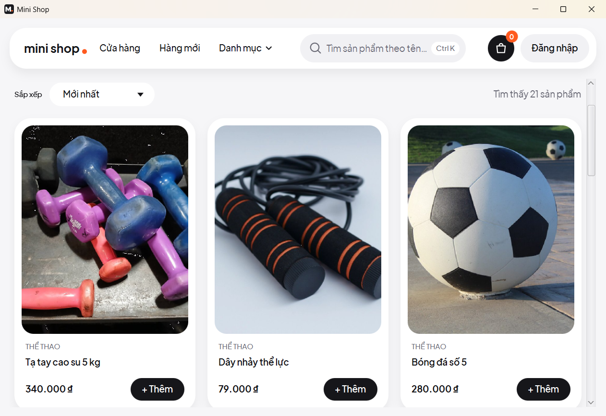
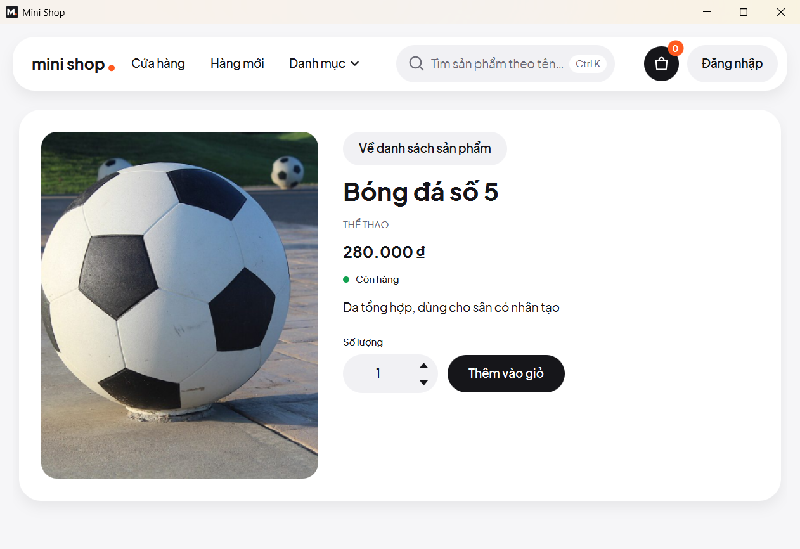
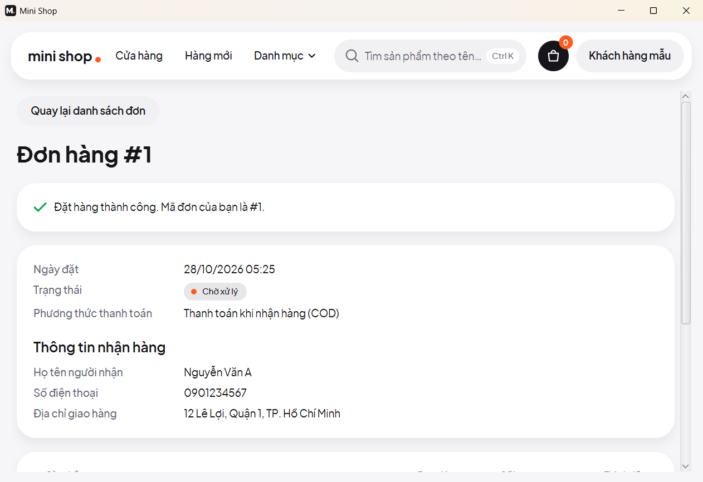
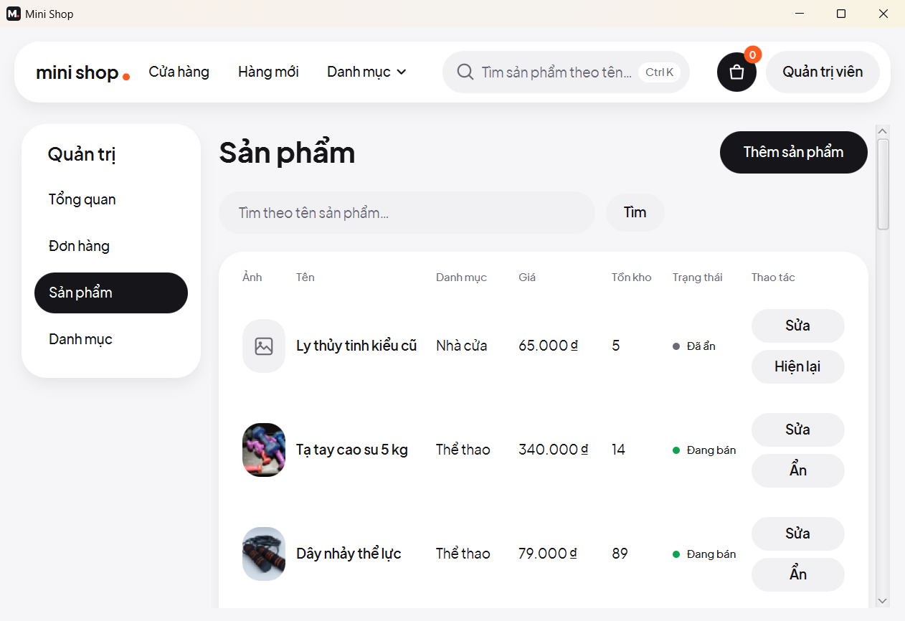
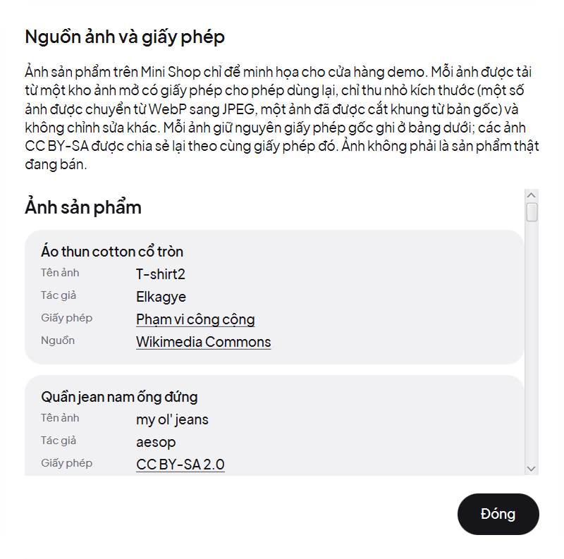

# Mini Shop

[](https://github.com/Luffyreals/mini-shop/actions/workflows/ci.yml)
**Mini Shop là ứng dụng bán hàng chạy trên Windows, viết hoàn toàn bằng Java.** Khách xem và tìm sản phẩm, bỏ vào giỏ, đặt hàng giao tận nơi (COD) và theo dõi đơn. Chủ shop quản lý danh mục, sản phẩm, tồn kho và đơn hàng ngay trong cùng cửa sổ.

Bản đóng gói mang theo Java riêng: tải về, giải nén, nhấp đúp là chạy. Không cần cài Java, database hay Docker.



> Đây là **dự án học tập tập trung vào UI/UX**, không phải cửa hàng thật: không có thanh toán thật và không gửi hàng. Dữ liệu chỉ nằm trên máy bạn.

## Có gì trong app

**Cho khách hàng**
- Trang chủ dùng dữ liệu thật: sản phẩm mới nhất, các sản phẩm sắp hết hàng, thông tin giao hàng.
- Tìm theo tên (`Ctrl+K`), lọc theo danh mục, sắp xếp theo giá hoặc độ mới, phân trang.
- Giỏ hàng trượt ra ngay trong cửa sổ, dùng được cả khi chưa đăng nhập. Khi đăng nhập, giỏ khách được gộp vào giỏ của tài khoản.
- Thanh toán khi nhận hàng (COD), xem lịch sử đơn và tự hủy đơn khi đơn còn "Chờ xử lý".

**Cho quản trị viên**
- Tổng quan: số đơn theo trạng thái, doanh thu, sản phẩm sắp hết hàng.
- Quản lý danh mục và sản phẩm, kèm ảnh JPG, PNG hoặc WebP.
- Điều chỉnh tồn kho, đổi trạng thái đơn theo đúng thứ tự (Chờ xử lý → Đã xác nhận → Đang giao → Đã giao). Hủy đơn thì tự hoàn kho.

**Trải nghiệm**
- Phong cách "soft modern": nền xám nhạt, thẻ trắng bo góc lớn, nút dạng viên thuốc, một màu nhấn cam, phông Plus Jakarta Sans đủ dấu tiếng Việt.
- Dùng được hoàn toàn bằng bàn phím: Tab, Enter, Esc, `Ctrl+K`.
- Cửa sổ không bao giờ "Not responding": mọi việc đọc ghi dữ liệu chạy nền.
- Hành động khó hoàn tác (hủy đơn, xác nhận đã giao, xóa danh mục) luôn hỏi lại, và nút được chọn sẵn là nút an toàn.
- Lỗi bất ngờ không để lại màn trống: màn hiện "Đã có lỗi xảy ra. Vui lòng thử lại." cùng nút "Thử lại".

## Ảnh màn hình

| | |
|---|---|
|  |  |
| Danh sách sản phẩm: tìm, lọc, sắp xếp | Chi tiết sản phẩm |
|  |  |
| Giỏ hàng trượt ra trong cửa sổ | Thanh toán khi nhận hàng |
|  |  |
| Đơn hàng vừa đặt | Tổng quan của quản trị viên |
|  |  |
| Quản lý sản phẩm | Hộp thoại "Nguồn ảnh": tác giả và giấy phép của từng ảnh |

## Tải và chạy

1. Tải `MiniShop-0.9.0-windows.zip` ở trang [Releases](https://github.com/Luffyreals/mini-shop/releases/latest) (khoảng 80 MB, Windows 10/11 64-bit).
2. Giải nén vào một thư mục có **đường dẫn không dấu**, ví dụ `C:\MiniShop`. Đường dẫn có chữ nằm ngoài bảng mã ANSI của Windows (ví dụ "ư" khi Windows dùng tiếng Anh) làm `MiniShop.exe` thoát ngay mà không báo gì.
3. Nhấp đúp `MiniShop.exe`. App chưa được ký số nên Windows SmartScreen có thể cảnh báo: bấm "Thông tin thêm" (More info) rồi "Vẫn chạy" (Run anyway).

Lần mở đầu app tự tạo dữ liệu mẫu: 5 danh mục, 22 sản phẩm và hai tài khoản demo. Bấm "Đăng nhập" ở góc trên phải:

| Vai trò | Email | Mật khẩu |
|---|---|---|
| Quản trị | `admin@minishop.local` | `Admin@123` |
| Khách hàng | `user@minishop.local` | `User@123` |

Dữ liệu nằm ở `%LOCALAPPDATA%\MiniShop`: database, ảnh upload trong `uploads\`, log trong `logs\mini-shop.log`. Xóa thư mục đó để làm lại dữ liệu mẫu. Mỗi lúc chỉ mở được một cửa sổ app; mở lần hai sẽ có thông báo "Mini Shop đang chạy ở một cửa sổ khác.".

## Chạy từ mã nguồn

Chỉ cần **JDK 25** (Windows: `winget install EclipseAdoptium.Temurin.25.JDK`, macOS: `brew install --cask temurin@25`, Linux: [adoptium.net](https://adoptium.net/temurin/releases/?version=25)).

```bash
git clone https://github.com/Luffyreals/mini-shop.git
cd mini-shop
./mvnw javafx:run
```

Trên Windows PowerShell dùng `.\mvnw.cmd javafx:run`. Lần đầu Maven tải thư viện nên mất vài phút; sau đó cửa sổ mở trong khoảng 10 giây. Chạy từ mã nguồn thì dữ liệu nằm ở `data/` trong thư mục repo.

| Việc cần làm | Lệnh |
|---|---|
| Build và chạy toàn bộ test | `./mvnw verify` (test dùng H2 trong bộ nhớ, không đụng `data/`; vài test giao diện mở cửa sổ thật trong giây lát) |
| Bỏ qua test giao diện | `./mvnw verify -DexcludedGroups=ui` |
| Chạy một lớp test | `./mvnw test -Dtest=OrderServiceTest` |
| Đặt dữ liệu ở thư mục khác | biến môi trường `DATA_DIR`, ví dụ `DATA_DIR=data2 ./mvnw javafx:run` |
| Làm lại dữ liệu mẫu | đóng app, xóa `data/`, chạy lại |
| Đóng gói bản Windows | `.\mvnw.cmd -Pjpackage -DskipTests package` (chỉ trên Windows), ra `target\dist\MiniShop\MiniShop.exe`. Tắt `MiniShop.exe` trước khi build lại |

**Xử lý sự cố**
- `release version 25 not supported`: máy đang dùng JDK cũ; cài JDK 25 hoặc đặt `JAVA_HOME` trỏ tới nó.
- "Mini Shop đang chạy ở một cửa sổ khác.": đóng cửa sổ đang mở (hoặc tiến trình `java` còn sót) rồi chạy lại.
- Nhấp đúp `MiniShop.exe` mà không thấy cửa sổ: kiểm tra đường dẫn thư mục app có dấu không, rồi xem `%LOCALAPPDATA%\MiniShop\logs\mini-shop.log`.

## Bên trong

| | |
|---|---|
| Ngôn ngữ | Java 25 |
| Giao diện | JavaFX 25, CSS của JavaFX, phông Plus Jakarta Sans đóng gói kèm |
| Nghiệp vụ | Spring Boot 4.1 không có web server: Data JPA, Validation, băm mật khẩu bằng BCrypt |
| Dữ liệu | H2 lưu ra file (chế độ tương thích PostgreSQL), Flyway |
| Kiểm thử | JUnit, Mockito, AssertJ, ArchUnit, TestFX: gần 3000 test, CI fail nếu có test bị bỏ qua |
| Đóng gói | `jpackage`: thư mục app có `MiniShop.exe` và runtime Java riêng |

Vài điểm thiết kế đáng chú ý (chi tiết ở [docs/architecture.md](docs/architecture.md)):
- **Modular monolith chia theo tính năng** (`catalog`, `cart`, `order`, `user`, `admin`). Chiều phụ thuộc giữa các tính năng được kiểm bằng ArchUnit; tính năng cần gọi ngược thì khai báo interface để tính năng kia cài đặt.
- **Không bán vượt kho:** tồn kho chỉ bị trừ bằng một câu `UPDATE` có điều kiện. Đặt và hủy đơn khóa dữ liệu theo một thứ tự cố định.
- **Đơn hàng giữ nguyên tên và giá lúc mua**, và mỗi khách chỉ thấy đơn của mình.
- **Quyền quản trị được kiểm ở tầng service**, không chỉ dựa vào việc ẩn menu.
- **Ảnh upload được kiểm cả nội dung file** (magic bytes), giới hạn 2 MB, lưu bằng tên ngẫu nhiên.

Lịch sử: đến `v0.8.0` Mini Shop là một website (Spring MVC + Thymeleaf), vẫn xem được ở tag [`v0.8.0`](https://github.com/Luffyreals/mini-shop/tree/v0.8.0). Từ `v0.9.0` app được làm lại thành ứng dụng desktop ([ADR-0014](docs/adr/0014-javafx-desktop-app.md)); các thay đổi theo từng phiên bản ở [CHANGELOG.md](CHANGELOG.md), lý do của các quyết định ở [docs/adr](docs/adr/README.md).

## Đóng góp

- Làm trên nhánh riêng (`feat/…`, `fix/…`, `docs/…`, `chore/…`), mở Pull Request vào `main` và chọn **Squash and merge**. `./mvnw verify` phải xanh; CI chạy lại khi mở PR.
- Commit message theo [Conventional Commits](https://www.conventionalcommits.org/), tiếng Anh, scope là tên tính năng: `feat(order): restore stock when an order is cancelled`.
- Chữ hiển thị tiếng Việt, tên trong code tiếng Anh. Đổi schema thì thêm migration Flyway mới, không sửa file cũ.
- Quyết định thay đổi kiến trúc, công nghệ hay ràng buộc nghiệp vụ thì viết ADR mới trong [docs/adr](docs/adr/README.md).

## Giấy phép

Mã nguồn và biểu tượng app: [MIT](LICENSE). Ảnh sản phẩm là ảnh minh họa có giấy phép mở, phông theo giấy phép SIL OFL; tác giả, giấy phép và nguồn của từng ảnh hiện trong hộp thoại **"Nguồn ảnh"** ở chân trang chủ (dữ liệu ở [`images/credits.tsv`](src/main/resources/images/credits.tsv), phông ở [`ui/fonts/`](src/main/resources/ui/fonts)). Ảnh WebP được đọc bằng [TwelveMonkeys ImageIO](https://github.com/haraldk/TwelveMonkeys) (BSD-3-Clause, văn bản ở [`src/packaging/licenses/`](src/packaging/licenses)). Bản đóng gói kèm giấy phép của mọi thư viện trong `app\THIRD-PARTY.txt`.
