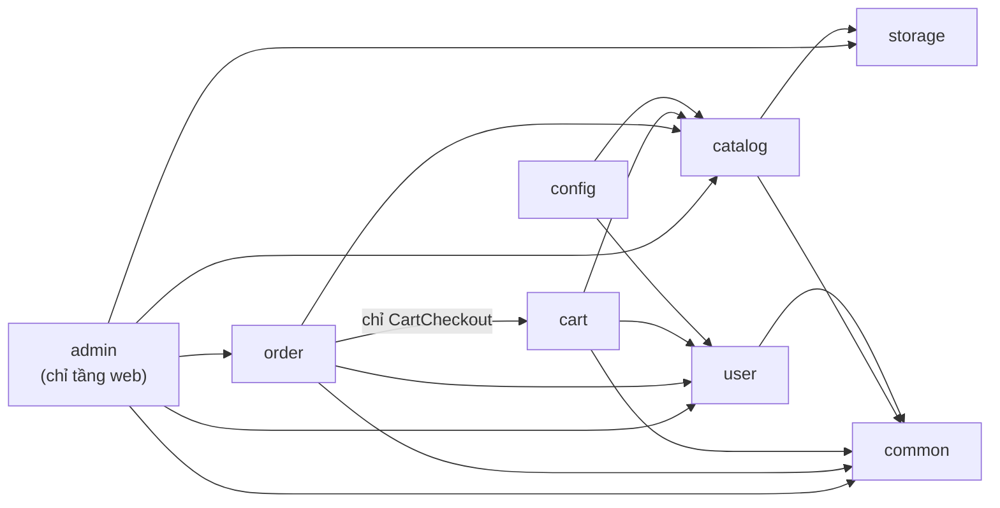
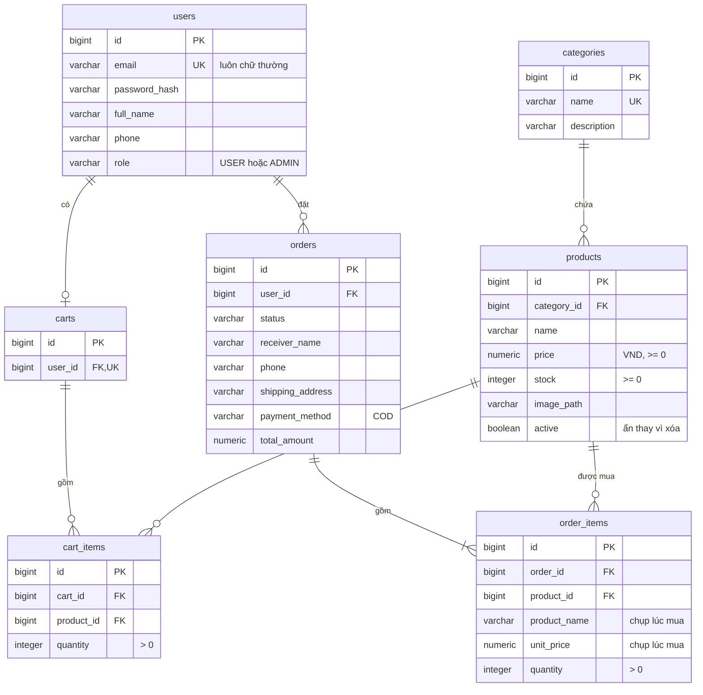

# Mini Shop

[](https://github.com/Luffyreals/mini-shop/actions/workflows/ci.yml)

Website bán hàng mini viết bằng Java / Spring Boot, render phía server bằng Thymeleaf. Đây là **dự án học tập tập trung vào UI/UX**: giao diện cửa hàng và trang quản trị được thiết kế riêng, tiếng Việt, đạt tương phản WCAG 2.1 AA. Đây không phải cửa hàng thật, không có thanh toán thật.

Clone về là chạy được, **chỉ cần JDK 25**: không cần Docker, không cần cài database. Dữ liệu lưu trong thư mục `data/` trên máy bạn, nên tắt app mở lại vẫn còn.


## Chạy thử

**1. Cài JDK 25** (bỏ qua nếu `java -version` đã in ra `25`):

| Hệ điều hành | Lệnh |
|---|---|
| Windows | `winget install EclipseAdoptium.Temurin.25.JDK` |
| macOS | `brew install --cask temurin@25` |
| Linux | tải từ [adoptium.net](https://adoptium.net/temurin/releases/?version=25) hoặc dùng trình quản lý gói của bản phân phối |

**2. Tải mã nguồn:**

```bash
git clone https://github.com/Luffyreals/mini-shop.git
cd mini-shop
```

**3. Chạy:**

```bash
./mvnw spring-boot:run
```

Trên Windows PowerShell dùng `.\mvnw.cmd spring-boot:run`. Lần chạy đầu tự tải Maven và thư viện nên mất vài phút; các lần sau chỉ vài giây. Khi log có dòng `Started MiniShopApplication`, mở **http://localhost:8080**. Dừng app bằng `Ctrl+C`.

### Tài khoản demo

Tự tạo ở lần chạy đầu, cùng 5 danh mục và 22 sản phẩm mẫu.

| Vai trò | Email | Mật khẩu |
|---|---|---|
| Quản trị (ADMIN) | `admin@minishop.local` | `Admin@123` |
| Khách hàng (USER) | `user@minishop.local` | `User@123` |

Hoặc tự đăng ký ở http://localhost:8080/register (tài khoản mới luôn là khách hàng).

### Gợi ý dạo một vòng

1. **Trang chủ**: tìm theo tên, lọc theo danh mục, sắp xếp theo giá, sang trang. Có sẵn một sản phẩm hết hàng và ba sản phẩm không có ảnh để xem cách giao diện xử lý.
2. **Giỏ hàng khi chưa đăng nhập**: thêm vài món, đổi số lượng, rồi đăng nhập bằng `user@minishop.local`: giỏ được gộp vào tài khoản.
3. **Đặt hàng** (thanh toán khi nhận hàng), xem "Đơn hàng của tôi", tự hủy đơn đang chờ xử lý.
4. **Quản trị**: đăng nhập `admin@minishop.local`, bấm "Quản trị" trên header. Xem dashboard, xác nhận và giao đơn, thêm sản phẩm có ảnh, nhập thêm tồn kho.
5. **Trang lỗi**: mở http://localhost:8080/products/999999 hoặc một đường dẫn không tồn tại.
6. **Bàn phím**: chỉ dùng `Tab` để đi hết một trang; link "Bỏ qua đến nội dung chính" hiện ở lần `Tab` đầu tiên.

## Tính năng

**Khách hàng**
- Xem sản phẩm: phân trang, tìm theo tên, lọc theo danh mục, sắp xếp theo giá; trang chi tiết sản phẩm
- Giỏ hàng: lưu trong session khi chưa đăng nhập, gộp vào tài khoản khi đăng nhập
- Đăng ký, đăng nhập; sai 5 lần với cùng email trong 15 phút thì bị chặn 15 phút
- Đặt hàng thanh toán khi nhận hàng (COD), xem lịch sử đơn, tự hủy đơn đang chờ xử lý

**Quản trị (`/admin`)**
- Dashboard: số đơn theo trạng thái, doanh thu đơn đã giao, sản phẩm sắp hết hàng, đơn mới nhất
- Quản lý danh mục và sản phẩm (upload ảnh JPG/PNG/WebP), ẩn/hiện sản phẩm, nhập thêm hoặc giảm tồn kho
- Quản lý đơn hàng: lọc theo trạng thái, đổi trạng thái; hủy đơn thì tự hoàn lại tồn kho

**Hoàn thiện**
- Trang lỗi tiếng Việt cho 404, 400/405, phiên hết hạn, tệp quá lớn, lỗi hệ thống; không bao giờ lộ stack trace
- Form tự bỏ ký tự vô hình, nhận số điện thoại dạng `+84…`; giá luôn hiển thị kiểu `1.250.000 ₫`

## Ảnh chụp

| Chi tiết sản phẩm | Giỏ hàng |
|---|---|
|  |  |
| **Thanh toán** | **Chi tiết đơn của khách** |
|  |  |
| **Dashboard quản trị** | **Chi tiết đơn trong quản trị** |
|  |  |

Ảnh chụp từ app chạy với dữ liệu mẫu (tên, số điện thoại, địa chỉ đều là dữ liệu giả).

## Giao diện (UI/UX)

Hai khu có hai hướng thiết kế riêng, mỗi hướng được chốt một lần rồi dùng lại cho mọi trang:

- **Cửa hàng**: hướng "The specimen catalogue": mỗi sản phẩm là một "mẫu vật" trên ô màu phẳng, cùng cỡ, như bảng tra trong sách hướng dẫn. Nền màu xương, mực đen, xanh lá chỉ dành cho nút chính. Một họ chữ duy nhất, Bricolage Grotesque, tự host, đủ dấu tiếng Việt và ký hiệu `₫`. Toàn bộ token (màu, chữ, khoảng cách) và lý do chọn nằm ở đầu [`static/css/app.css`](src/main/resources/static/css/app.css).
- **Quản trị**: giao diện màn hình làm việc, dày thông tin và dễ quét ([`static/css/admin.css`](src/main/resources/static/css/admin.css), mọi selector nằm dưới `.admin-body`).

Nguyên tắc chung:
- Bootstrap 5.3 (tải qua WebJars, không dùng CDN) làm nền, ghi đè bằng token riêng; không gradient, không đổ bóng khi nghỉ, không viền trang trí.
- **Content Security Policy chặt** (`default-src 'self'`): template không có `<script>` nội tuyến, `style="…"` hay `onclick`; mọi CSS/JS nằm trong `static/`, font và ảnh tự host. `TemplateCspComplianceTest` quét mọi template để giữ quy tắc này.
- Truy cập: link bỏ qua, viền focus rõ ràng, mọi ô nhập có nhãn, tương phản AA, hiệu ứng tắt khi bật `prefers-reduced-motion`. App vẫn dùng được khi tắt JavaScript.
- Các mảnh dùng chung (header, footer, thẻ sản phẩm, phân trang) ở [`templates/fragments/`](src/main/resources/templates/fragments); mỗi tính năng có thư mục template riêng.

Ảnh sản phẩm là ảnh minh họa có giấy phép mở (CC0, public domain, CC BY, CC BY-SA), **không phải ảnh sản phẩm thật**. Tác giả và giấy phép từng ảnh nằm ở trang `/credits.html` ("Nguồn ảnh" ở footer). Font dùng giấy phép SIL OFL 1.1 (`static/fonts/OFL.txt`). Thêm hoặc đổi ảnh thì cập nhật cả `static/credits.html`.

## Dữ liệu được lưu ở đâu

App dùng **H2**, một database viết bằng Java chạy ngay bên trong app, lưu ra file. Mọi dữ liệu sinh ra khi chạy nằm trong một thư mục, không được commit lên git:

```
data/
├── minishop.mv.db   database: tài khoản, giỏ hàng, đơn hàng, sản phẩm
└── uploads/         ảnh admin upload
```

- **Làm lại từ đầu**: dừng app, xóa thư mục `data/`, chạy lại. App tự tạo bảng và dữ liệu mẫu.
- **Sao lưu**: dừng app rồi chép thư mục `data/`.
- **Đặt chỗ khác**: biến môi trường `DATA_DIR`, ví dụ Git Bash `DATA_DIR=/d/minishop-data ./mvnw spring-boot:run`, PowerShell `$env:DATA_DIR = "D:\minishop-data"; .\mvnw.cmd spring-boot:run`.
- **Xem bảng trực tiếp**: mở http://localhost:8080/h2-console trong lúc app chạy, điền:
  - JDBC URL: `jdbc:h2:file:./data/minishop;MODE=PostgreSQL;DATABASE_TO_LOWER=TRUE;DEFAULT_NULL_ORDERING=HIGH`
  - User Name: `sa`, Password để trống.

  Console chỉ mở được từ chính máy chạy app.

Mỗi lúc chỉ một app được mở `data/`: chạy bản thứ hai trên cùng thư mục sẽ báo file đang bị khóa. Schema do Flyway quản lý (`src/main/resources/db/migration`); muốn đổi bảng thì thêm file migration mới, không sửa file cũ.

## Lệnh thường dùng

| Việc cần làm | Lệnh |
|---|---|
| Chạy app | `./mvnw spring-boot:run` |
| Chạy ở cổng khác | `./mvnw spring-boot:run "-Dspring-boot.run.arguments=--server.port=8081"` |
| Build và chạy toàn bộ test | `./mvnw verify` |
| Chạy một lớp test | `./mvnw test -Dtest=ProductControllerTest` |
| Kiểm tra không có test nào bị bỏ qua (CI cũng chạy) | `bash .github/scripts/check-no-skipped-tests.sh` |
| Xem độ phủ test | mở `target/site/jacoco/index.html` sau `./mvnw verify` |

Trên Windows PowerShell thay `./mvnw` bằng `.\mvnw.cmd` và đặt tham số `-D…` trong nháy kép. Test dùng H2 trong bộ nhớ, không bao giờ đụng vào `data/` của bạn.

## Xử lý sự cố

| Triệu chứng | Cách xử lý |
|---|---|
| `java: command not found`, hoặc lỗi `release version 25 not supported` | Cài JDK 25 (mục [Chạy thử](#chạy-thử)), mở terminal mới rồi kiểm `java -version`. Nếu máy có nhiều JDK, đặt `JAVA_HOME` trỏ tới JDK 25. |
| `Port 8080 was already in use` | Tắt chương trình đang dùng cổng 8080, hoặc chạy ở cổng khác (bảng [Lệnh thường dùng](#lệnh-thường-dùng)). |
| `Database may be already in use` | Đang có một app khác mở `data/` (thường là bản cũ chưa tắt hẳn). Tắt nó rồi chạy lại. |
| Muốn dữ liệu mẫu như mới | Dừng app, xóa thư mục `data/`, chạy lại. |
| Đăng nhập báo "Bạn đã đăng nhập sai quá nhiều lần" | Đợi 15 phút, hoặc khởi động lại app để xóa bộ đếm. |

## Công nghệ

| | |
|---|---|
| Ngôn ngữ | Java 25 |
| Framework | Spring Boot 4.1: Web MVC, Data JPA, Security, Validation |
| Giao diện | Thymeleaf, Bootstrap 5.3, CSS riêng, không framework JavaScript |
| Cơ sở dữ liệu | H2 lưu ra file (chế độ tương thích PostgreSQL), Flyway |
| Kiểm thử | JUnit 5, Mockito, AssertJ, MockMvc, ArchUnit |
| Build | Maven Wrapper |

## Kiến trúc

Modular monolith: chia package theo tính năng (`catalog`, `cart`, `order`, `user`, `admin`…), trong mỗi tính năng phân lớp controller → service → repository. Một vài điểm thiết kế đáng chú ý:

- Trừ tồn kho bằng câu `UPDATE` nguyên tử nên không bán vượt kho khi nhiều người đặt cùng lúc ([ADR-0005](docs/adr/0005-atomic-stock-decrement.md))
- Đơn hàng lưu lại tên và giá sản phẩm tại thời điểm mua
- Luồng trạng thái đơn được kiểm soát chặt: `PENDING → CONFIRMED → SHIPPING → DELIVERED`, hoặc `CANCELLED`
- Ảnh upload được kiểm cả nội dung file (magic bytes) và lưu bằng tên ngẫu nhiên ([ADR-0010](docs/adr/0010-product-images-and-admin-stock-adjustment.md))

**Các package và chiều phụ thuộc** (mũi tên = "được phép dùng"; `ArchitectureTest` làm build thất bại nếu sai):



<details>
<summary><b>Các bảng</b> (Flyway <code>V1</code>, <code>V2</code>)</summary>



</details>

Phạm vi và lộ trình ban đầu: [docs/project-brief.md](docs/project-brief.md); đặc tả từng giai đoạn: [docs/specs](docs/specs/README.md).

## Quyết định thiết kế

Mỗi quyết định có một ADR ghi bối cảnh, lựa chọn và phương án đã loại ([docs/adr](docs/adr/README.md)):

| ADR | Chọn gì | Vì sao |
|---|---|---|
| [0001](docs/adr/0001-java-25-spring-boot-4.md) | Java 25, Spring Boot 4.1 | Bản LTS mới nhất; dòng Boot 3.x đã hết hỗ trợ miễn phí |
| [0002](docs/adr/0002-modular-monolith-package-by-feature.md) | Modular monolith, package theo tính năng | Một người, một miền nghiệp vụ nhỏ; ranh giới module được kiểm bằng ArchUnit |
| [0003](docs/adr/0003-server-side-rendering-thymeleaf.md) | Render phía server bằng Thymeleaf | Một dự án, session + CSRF có sẵn |
| [0005](docs/adr/0005-atomic-stock-decrement.md) | Trừ kho bằng `UPDATE … WHERE stock >= :q` | Không bán vượt kho khi nhiều người đặt cùng lúc |
| [0006](docs/adr/0006-session-cart-merged-on-login.md) | Giỏ trong session cho khách, trong DB cho user, gộp khi đăng nhập | Khách mua được ngay, không mất giỏ khi đăng nhập |
| [0007](docs/adr/0007-session-form-login-current-user.md) | Đăng nhập bằng form trên session, principal riêng | Không giữ entity trong session; email luôn chữ thường |
| [0008](docs/adr/0008-cart-writes-serialized-per-user.md) | Ghi giỏ DB tuần tự theo người dùng (khóa dòng `users`) | Hai tab cùng sửa giỏ không ghi đè nhau |
| [0009](docs/adr/0009-order-placement-and-cancel-locking.md) | Thứ tự khóa cố định khi đặt và hủy đơn | Không deadlock, kho chỉ được hoàn một lần |
| [0010](docs/adr/0010-product-images-and-admin-stock-adjustment.md) | Ảnh qua `StorageService`, admin chỉnh kho bằng `UPDATE` có điều kiện | File upload không thành bề mặt tấn công; không ghi đè số khách vừa mua |
| [0011](docs/adr/0011-centralized-error-handling.md) | Xử lý lỗi tập trung | Mọi lỗi có trang tiếng Việt đúng mã, không lộ chi tiết |
| [0012](docs/adr/0012-share-from-personal-machine-public-mode.md) | Chia sẻ từ máy cá nhân qua Cloudflare Quick Tunnel, chế độ `public` (sau MVP) | Miễn phí, không cần PaaS; mở ra internet một cách an toàn |
| [0013](docs/adr/0013-h2-file-database-no-docker.md) | H2 lưu ra file trong `data/`, bỏ PostgreSQL và Docker | Ai clone cũng chạy được chỉ với JDK; dữ liệu còn sau khi tắt app |

## Cấu trúc repo

```
mini-shop/
├── src/main/java/com/minishop/
│   ├── catalog/ cart/ order/ user/   Các tính năng nghiệp vụ
│   ├── admin/                        Tầng web của khu quản trị
│   └── storage/ common/ config/      Lưu file, thành phần dùng chung, cấu hình
├── src/main/resources/
│   ├── templates/       Giao diện Thymeleaf (fragments/ dùng chung, mỗi tính năng một thư mục)
│   ├── static/          CSS, JS, font, ảnh sản phẩm mẫu, trang nguồn ảnh
│   ├── db/migration/    Schema (Flyway)
│   └── application*.yml Cấu hình: mặc định và public (chia sẻ qua tunnel, sau MVP)
├── src/test/            Test (JUnit, MockMvc, ArchUnit)
├── docs/
│   ├── adr/             Các quyết định kiến trúc
│   ├── specs/           Đặc tả tính năng và tiêu chí chấp nhận
│   ├── plans/           Kế hoạch chi tiết từng giai đoạn
│   ├── images/          Ảnh chụp màn hình cho README
│   ├── deploy-cloudflare.md  Chia sẻ app qua Cloudflare Tunnel (sau MVP)
│   └── project-brief.md Phạm vi và lộ trình ban đầu
├── .github/             CI, Dependabot, template PR và issue
├── mvnw, mvnw.cmd       Maven Wrapper (không cần cài Maven)
├── CONTRIBUTING.md      Quy trình nhánh, commit, phát hành
└── CHANGELOG.md
```

Thư mục `data/` (database, ảnh upload) và `target/` (build) được tạo khi chạy và không nằm trong git.

## Lộ trình

- [x] GĐ1: Khởi tạo project, CI, entity, migration, dữ liệu mẫu (`v0.1.0`)
- [x] GĐ2: Danh sách và chi tiết sản phẩm (`v0.2.0`)
- [x] GĐ3: Đăng ký, đăng nhập, phân quyền (`v0.3.0`)
- [x] GĐ4: Giỏ hàng (`v0.4.0`)
- [x] GĐ5: Đặt hàng và lịch sử đơn (`v0.5.0`)
- [x] GĐ6: Trang quản trị (`v0.6.0`)
- [x] GĐ7: Hoàn thiện: validation, xử lý lỗi, giao diện, tài liệu (`v0.7.0`)
- [x] GĐ8: Chế độ `public` để chia sẻ qua tunnel (`v0.8.0`)
- [x] Tái cấu trúc: chạy chỉ với JDK, dữ liệu lưu trong `data/`, repo public

**Sau MVP**
- [ ] Deploy: chia sẻ app đang chạy trên máy qua Cloudflare Tunnel (máy phải bật). Code đã có; hướng dẫn tạm ở [docs/deploy-cloudflare.md](docs/deploy-cloudflare.md)

## Hướng phát triển

Ngoài phạm vi MVP, có thể làm sau (ngoài phần deploy ở trên):
- Quên mật khẩu (cần gửi email)
- Tìm đơn theo email, số điện thoại, mã đơn trong trang quản trị; lọc sản phẩm quản trị theo danh mục
- Chạy 24/7 trên một PaaS: cần Docker image, một database được quản lý và nơi lưu ảnh khác ổ đĩa của máy chủ (đổi bản cài đặt `StorageService`)

## Đóng góp

Xem [CONTRIBUTING.md](CONTRIBUTING.md).

## Giấy phép

Mã nguồn: [MIT](LICENSE). Ảnh sản phẩm và font theo giấy phép riêng của từng tác giả (xem `/credits.html` và `static/fonts/OFL.txt`).
