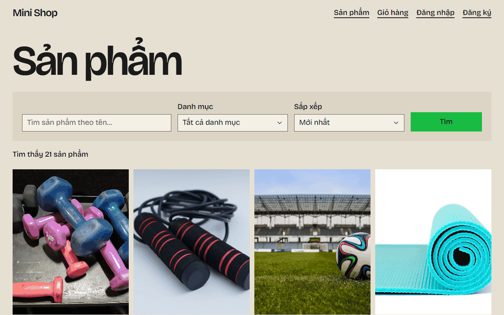
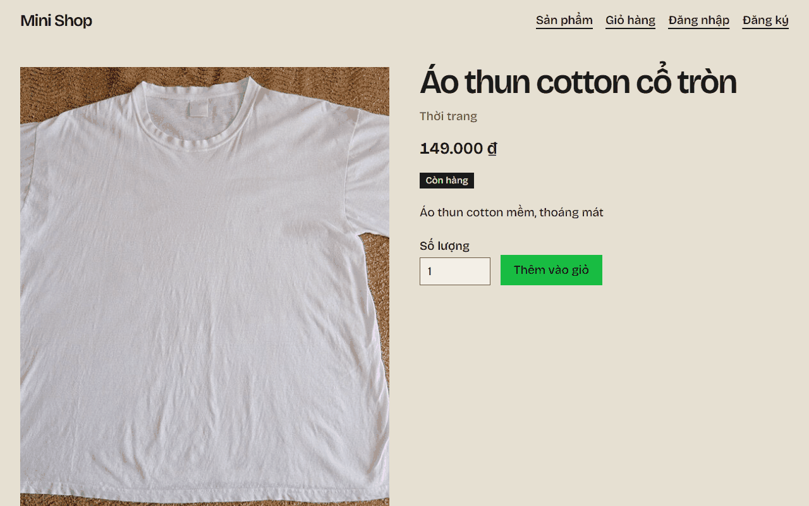
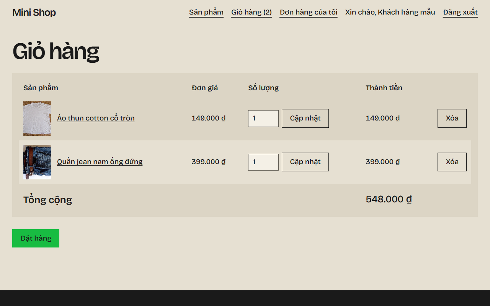
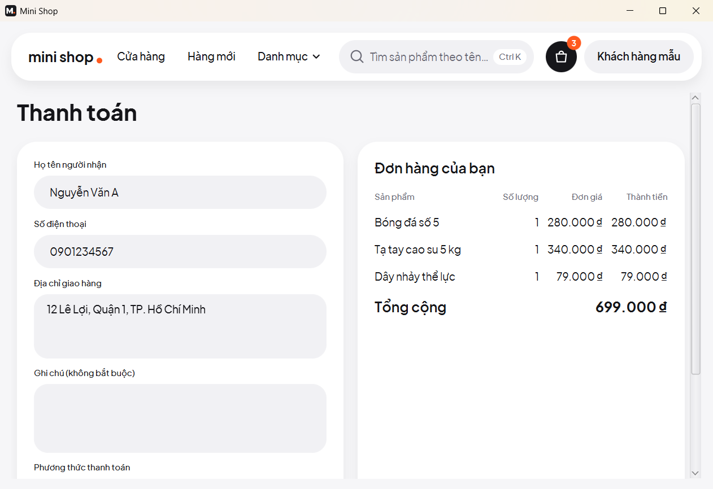
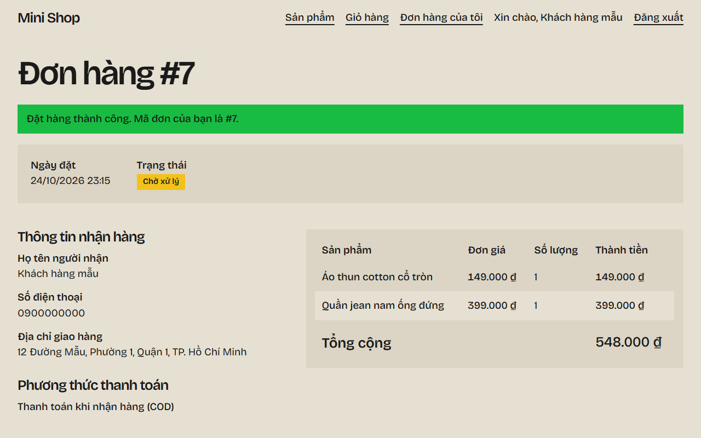
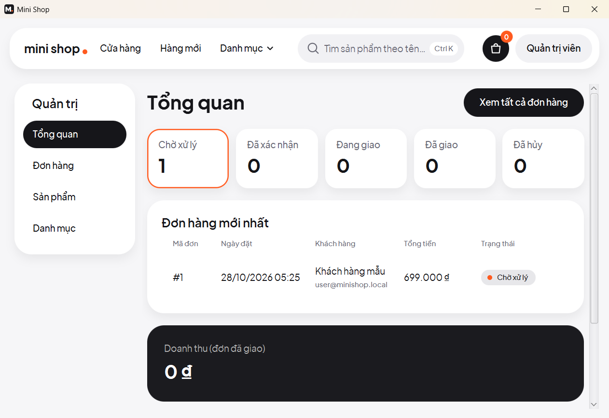
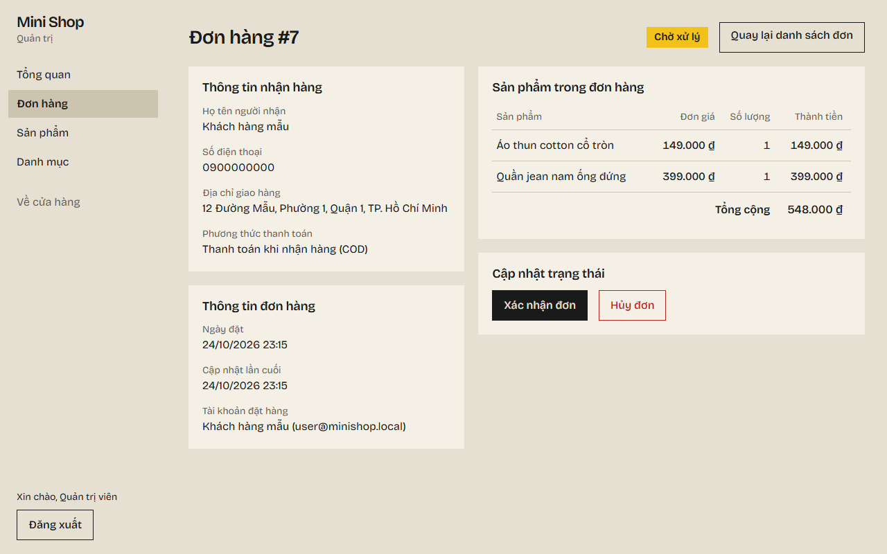

# Mini Shop

[](https://github.com/Luffyreals/mini-shop/actions/workflows/ci.yml)

Website bán hàng mini viết bằng Java / Spring Boot, render phía server bằng Thymeleaf. Đây là **dự án học tập tập trung vào UI/UX**: giao diện cửa hàng và trang quản trị được thiết kế riêng, tiếng Việt, đạt tương phản WCAG 2.1 AA. Không phải cửa hàng thật, không có thanh toán thật.

Clone về là chạy được, **chỉ cần JDK 25**: không cần Docker, không cần cài database. Dữ liệu lưu trong thư mục `data/` trên máy bạn, nên tắt app mở lại vẫn còn.



## Chạy thử

1. **Cài JDK 25** (bỏ qua nếu `java -version` đã in ra `25`): Windows `winget install EclipseAdoptium.Temurin.25.JDK`, macOS `brew install --cask temurin@25`, Linux tải từ [adoptium.net](https://adoptium.net/temurin/releases/?version=25).
2. **Tải mã nguồn và chạy:**

   ```bash
   git clone https://github.com/Luffyreals/mini-shop.git
   cd mini-shop
   ./mvnw spring-boot:run
   ```

   Trên Windows PowerShell dùng `.\mvnw.cmd spring-boot:run`. Lần chạy đầu tự tải Maven và thư viện nên mất vài phút.
3. Khi log có dòng `Started MiniShopApplication`, mở **http://localhost:8080**. Dừng app bằng `Ctrl+C`.

**Tài khoản demo** (tự tạo ở lần chạy đầu, cùng 5 danh mục và 22 sản phẩm mẫu):

| Vai trò | Email | Mật khẩu |
|---|---|---|
| Quản trị | `admin@minishop.local` | `Admin@123` |
| Khách hàng | `user@minishop.local` | `User@123` |

**Gợi ý dạo một vòng:**
1. Trang chủ: tìm, lọc theo danh mục, sắp xếp theo giá. Có sẵn sản phẩm hết hàng và sản phẩm không có ảnh.
2. Thêm hàng vào giỏ khi chưa đăng nhập, rồi đăng nhập: giỏ được gộp vào tài khoản.
3. Đặt hàng (thanh toán khi nhận hàng), xem "Đơn hàng của tôi", tự hủy đơn đang chờ xử lý.
4. Đăng nhập admin, bấm "Quản trị": xử lý đơn, thêm sản phẩm có ảnh, nhập thêm tồn kho.
5. Mở http://localhost:8080/products/999999 để xem trang lỗi; chỉ dùng `Tab` để đi hết một trang.

## Tính năng

- **Khách hàng:** xem, tìm, lọc, sắp xếp sản phẩm; giỏ hàng cho cả khách chưa đăng nhập; đăng ký, đăng nhập (chặn tạm khi sai nhiều lần); đặt hàng COD, lịch sử đơn, tự hủy đơn.
- **Quản trị (`/admin`):** dashboard (đơn theo trạng thái, doanh thu, sắp hết hàng); quản lý danh mục, sản phẩm có ảnh, tồn kho; đổi trạng thái đơn, hủy đơn tự hoàn kho.
- **Hoàn thiện:** trang lỗi tiếng Việt cho mọi mã lỗi, không lộ stack trace; giá hiển thị kiểu `1.250.000 ₫`; dùng được bằng bàn phím và khi tắt JavaScript.

## Ảnh chụp

| Chi tiết sản phẩm | Giỏ hàng |
|---|---|
|  |  |
| **Thanh toán** | **Chi tiết đơn của khách** |
|  |  |
| **Dashboard quản trị** | **Chi tiết đơn trong quản trị** |
|  |  |

Dữ liệu trong ảnh (tên, số điện thoại, địa chỉ) là dữ liệu giả.

## Giao diện (UI/UX)

- **Cửa hàng:** hướng "The specimen catalogue": mỗi sản phẩm là một "mẫu vật" trên ô màu phẳng, cùng cỡ, như bảng tra trong sách hướng dẫn. Nền màu xương, mực đen, xanh lá chỉ cho nút chính; một họ chữ Bricolage Grotesque tự host, đủ dấu tiếng Việt. Token màu, chữ, khoảng cách và lý do chọn nằm ở đầu [`static/css/app.css`](src/main/resources/static/css/app.css).
- **Quản trị:** màn hình làm việc, dày thông tin, dễ quét ([`static/css/admin.css`](src/main/resources/static/css/admin.css)).
- **Quy tắc chung:** Bootstrap 5.3 (qua WebJars, không CDN) ghi đè bằng token riêng; Content Security Policy chặt nên template không có script, style hay `onclick` nội tuyến (`TemplateCspComplianceTest` kiểm); link bỏ qua, focus rõ ràng, tôn trọng `prefers-reduced-motion`. Các mảnh dùng chung ở [`templates/fragments/`](src/main/resources/templates/fragments).

Ảnh sản phẩm là ảnh minh họa có giấy phép mở, không phải ảnh sản phẩm thật; tác giả và giấy phép ở trang `/credits.html` ("Nguồn ảnh" ở footer).

## Dữ liệu và lệnh thường dùng

App dùng **H2**, một database viết bằng Java chạy bên trong app, lưu ra `data/minishop.mv.db`; ảnh admin upload nằm ở `data/uploads/`. Thư mục `data/` không nằm trong git.

| Việc cần làm | Cách làm |
|---|---|
| Làm lại dữ liệu mẫu từ đầu | Dừng app, xóa thư mục `data/`, chạy lại |
| Đặt dữ liệu ở thư mục khác | Biến môi trường `DATA_DIR`, ví dụ `DATA_DIR=/d/minishop-data ./mvnw spring-boot:run` |
| Xem bảng trực tiếp | http://localhost:8080/h2-console, JDBC URL `jdbc:h2:file:./data/minishop;MODE=PostgreSQL;DATABASE_TO_LOWER=TRUE;DEFAULT_NULL_ORDERING=HIGH`, user `sa`, mật khẩu trống (chỉ mở được từ máy chạy app) |
| Chạy ở cổng khác | `./mvnw spring-boot:run "-Dspring-boot.run.arguments=--server.port=8081"` |
| Build và chạy toàn bộ test | `./mvnw verify` (test dùng H2 trong bộ nhớ, không đụng `data/`) |
| Chạy một lớp test | `./mvnw test -Dtest=ProductControllerTest` |

**Xử lý sự cố:**
- `release version 25 not supported`: máy đang dùng JDK cũ hơn; cài JDK 25 hoặc đặt `JAVA_HOME` trỏ tới nó.
- `Port 8080 was already in use`: tắt chương trình đang dùng cổng 8080, hoặc chạy ở cổng khác.
- `Database may be already in use`: đang có một app khác mở `data/` (thường là bản cũ chưa tắt hẳn); tắt nó rồi chạy lại.
- "Bạn đã đăng nhập sai quá nhiều lần": đợi 15 phút, hoặc khởi động lại app.

## Tài liệu

- [docs/architecture.md](docs/architecture.md): công nghệ, package và chiều phụ thuộc, các bảng, cấu trúc repo.
- [docs/adr](docs/adr/README.md): các quyết định kiến trúc và lý do.
- [CHANGELOG.md](CHANGELOG.md): thay đổi theo từng phiên bản.
- [docs/deploy-cloudflare.md](docs/deploy-cloudflare.md): chia sẻ app qua Cloudflare Tunnel (sau MVP).

## Lộ trình

- [x] GĐ1–GĐ8 (`v0.1.0`–`v0.8.0`): nền móng, sản phẩm, đăng nhập, giỏ hàng, đặt hàng, quản trị, hoàn thiện, chế độ `public`
- [x] Tái cấu trúc: chạy chỉ với JDK, dữ liệu lưu trong `data/`, repo gọn để public
- [ ] Sau MVP: chia sẻ app đang chạy trên máy qua Cloudflare Tunnel (máy phải bật); quên mật khẩu; tìm đơn trong trang quản trị

## Đóng góp

- Làm trên nhánh riêng (`feat/…`, `fix/…`, `docs/…`, `chore/…`), mở Pull Request vào `main` và chọn **Squash and merge**. `./mvnw verify` phải xanh; CI chạy lại khi mở PR.
- Commit message theo [Conventional Commits](https://www.conventionalcommits.org/), tiếng Anh, scope là tên tính năng: `feat(order): restore stock when an order is cancelled`.
- Chữ hiển thị tiếng Việt, tên trong code tiếng Anh. Đổi schema thì thêm migration Flyway mới, không sửa file cũ.
- Quyết định thay đổi kiến trúc, công nghệ hay ràng buộc nghiệp vụ thì viết ADR mới trong [docs/adr](docs/adr/README.md).

## Giấy phép

Mã nguồn: [MIT](LICENSE). Ảnh sản phẩm và font theo giấy phép riêng của từng tác giả (xem `/credits.html` và `static/fonts/OFL.txt`).
