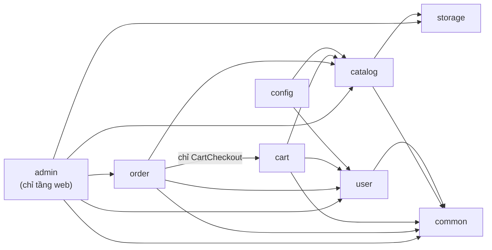
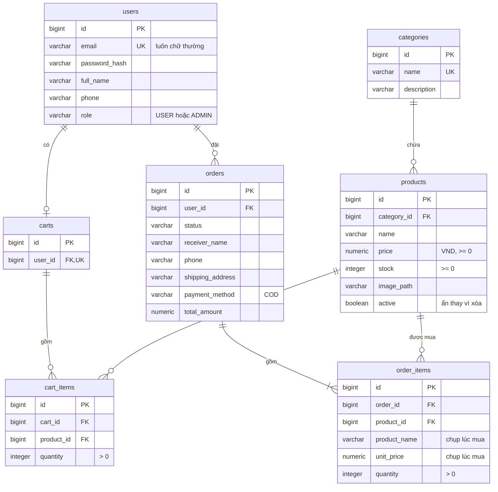

# Kiến trúc Mini Shop

Tài liệu cho người muốn đọc code: công nghệ, cách chia package, các bảng, các quyết định thiết kế và cấu trúc repo. Cách chạy app xem [README](../README.md).

## Công nghệ

| | |
|---|---|
| Ngôn ngữ | Java 25 |
| Framework | Spring Boot 4.1: Web MVC, Data JPA, Security, Validation |
| Giao diện | Thymeleaf, Bootstrap 5.3, CSS riêng, không framework JavaScript |
| Cơ sở dữ liệu | H2 lưu ra file (chế độ tương thích PostgreSQL), Flyway |
| Kiểm thử | JUnit 5, Mockito, AssertJ, MockMvc, ArchUnit |
| Build | Maven Wrapper |

## Kiến trúc

Modular monolith: chia package theo tính năng (`catalog`, `cart`, `order`, `user`, `admin`…), trong mỗi tính năng phân lớp controller → service → repository. Một vài điểm thiết kế đáng chú ý:

- Trừ tồn kho bằng câu `UPDATE` nguyên tử nên không bán vượt kho khi nhiều người đặt cùng lúc ([ADR-0005](adr/0005-atomic-stock-decrement.md))
- Đơn hàng lưu lại tên và giá sản phẩm tại thời điểm mua
- Luồng trạng thái đơn được kiểm soát chặt: `PENDING → CONFIRMED → SHIPPING → DELIVERED`, hoặc `CANCELLED`
- Ảnh upload được kiểm cả nội dung file (magic bytes) và lưu bằng tên ngẫu nhiên ([ADR-0010](adr/0010-product-images-and-admin-stock-adjustment.md))

**Các package và chiều phụ thuộc** (mũi tên = "được phép dùng"; `ArchitectureTest` làm build thất bại nếu sai):



<details>
<summary><b>Các bảng</b> (Flyway <code>V1</code>, <code>V2</code>)</summary>



</details>

Phạm vi, đặc tả và kế hoạch của từng giai đoạn GĐ1–GĐ8 được giữ ở tag [`v0.8.0`](https://github.com/Luffyreals/mini-shop/tree/v0.8.0/docs).

## Quyết định thiết kế

Mỗi quyết định có một ADR ghi bối cảnh, lựa chọn và phương án đã loại ([docs/adr](adr/README.md)):

| ADR | Chọn gì | Vì sao |
|---|---|---|
| [0001](adr/0001-java-25-spring-boot-4.md) | Java 25, Spring Boot 4.1 | Bản LTS mới nhất; dòng Boot 3.x đã hết hỗ trợ miễn phí |
| [0002](adr/0002-modular-monolith-package-by-feature.md) | Modular monolith, package theo tính năng | Một người, một miền nghiệp vụ nhỏ; ranh giới module được kiểm bằng ArchUnit |
| [0003](adr/0003-server-side-rendering-thymeleaf.md) | Render phía server bằng Thymeleaf | Một dự án, session + CSRF có sẵn |
| [0005](adr/0005-atomic-stock-decrement.md) | Trừ kho bằng `UPDATE … WHERE stock >= :q` | Không bán vượt kho khi nhiều người đặt cùng lúc |
| [0006](adr/0006-session-cart-merged-on-login.md) | Giỏ trong session cho khách, trong DB cho user, gộp khi đăng nhập | Khách mua được ngay, không mất giỏ khi đăng nhập |
| [0007](adr/0007-session-form-login-current-user.md) | Đăng nhập bằng form trên session, principal riêng | Không giữ entity trong session; email luôn chữ thường |
| [0008](adr/0008-cart-writes-serialized-per-user.md) | Ghi giỏ DB tuần tự theo người dùng (khóa dòng `users`) | Hai tab cùng sửa giỏ không ghi đè nhau |
| [0009](adr/0009-order-placement-and-cancel-locking.md) | Thứ tự khóa cố định khi đặt và hủy đơn | Không deadlock, kho chỉ được hoàn một lần |
| [0010](adr/0010-product-images-and-admin-stock-adjustment.md) | Ảnh qua `StorageService`, admin chỉnh kho bằng `UPDATE` có điều kiện | File upload không thành bề mặt tấn công; không ghi đè số khách vừa mua |
| [0011](adr/0011-centralized-error-handling.md) | Xử lý lỗi tập trung | Mọi lỗi có trang tiếng Việt đúng mã, không lộ chi tiết |
| [0012](adr/0012-share-from-personal-machine-public-mode.md) | Chia sẻ từ máy cá nhân qua Cloudflare Quick Tunnel, chế độ `public` (sau MVP) | Miễn phí, không cần PaaS; mở ra internet một cách an toàn |
| [0013](adr/0013-h2-file-database-no-docker.md) | H2 lưu ra file trong `data/`, bỏ PostgreSQL và Docker | Ai clone cũng chạy được chỉ với JDK; dữ liệu còn sau khi tắt app |

## Cấu trúc repo

```
mini-shop/
├── src/main/java/com/minishop/
│   ├── catalog/ cart/ order/ user/   Các tính năng nghiệp vụ
│   ├── admin/                        Tầng web của khu quản trị
│   └── storage/ common/ config/      Lưu file, thành phần dùng chung, cấu hình
├── src/main/resources/
│   ├── templates/       Giao diện Thymeleaf (fragments/ dùng chung, mỗi tính năng một thư mục)
│   ├── static/          CSS, JS, font, ảnh sản phẩm mẫu, trang nguồn ảnh
│   ├── db/migration/    Schema (Flyway)
│   └── application*.yml Cấu hình: mặc định và public (chia sẻ qua tunnel, sau MVP)
├── src/test/            Test (JUnit, MockMvc, ArchUnit)
├── docs/
│   ├── architecture.md  Tài liệu này
│   ├── adr/             Các quyết định kiến trúc
│   ├── images/          Ảnh chụp màn hình cho README
│   └── deploy-cloudflare.md  Chia sẻ app qua Cloudflare Tunnel (sau MVP)
├── .github/             CI: build, test, kiểm không có test bị bỏ qua
├── pom.xml, mvnw, mvnw.cmd   Maven và Maven Wrapper (không cần cài Maven)
├── CHANGELOG.md
└── LICENSE
```

Thư mục `data/` (database, ảnh upload) và `target/` (build) được tạo khi chạy và không nằm trong git.
